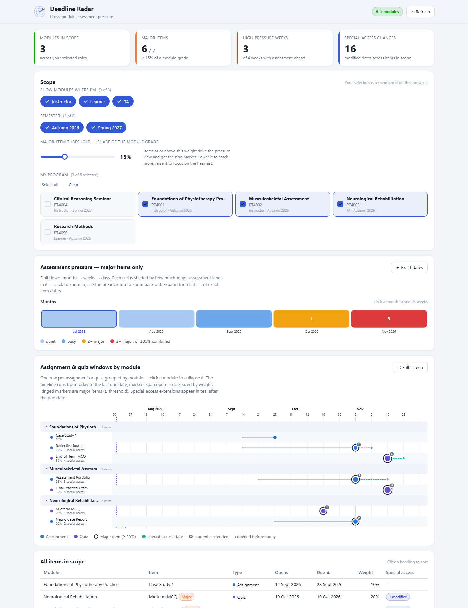
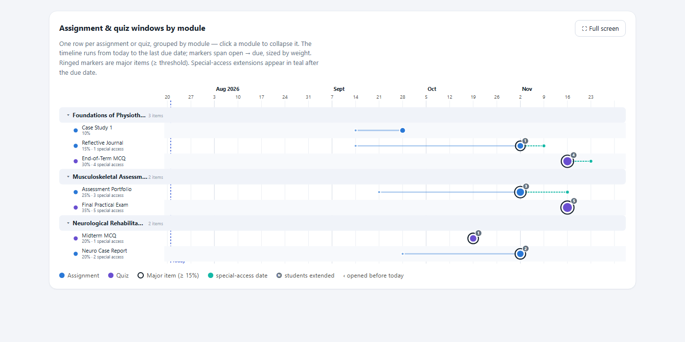

# Deadline Radar

A lightweight Brightspace (D2L) widget that shows the assignment and quiz windows across **all the modules you pick** on one timeline, filtered by the role(s) you hold, and flags the weeks where too much lands on students at once — weighted by each item's **share of the module grade**, not a raw count.

It answers a question no single-course view in Brightspace can: *is my programme piling heavy assessment into the same few weeks?* Built for programme coordinators and anyone teaching across several modules.

Works with any Brightspace instance. No server, no API keys — it runs on the page inside Brightspace using your own login session, and only ever **reads**.

---

## Screenshots

*Demonstration modules. The **Assessment pressure** strip (month view) flags November as the heaviest month — click a month to drill into its weeks, then a week into its days. The timeline below breaks each module into its items.*

*One row per assignment or quiz, grouped by module. Ringed markers are major items; teal dashes are special-access extensions running past the due date.*

---

## What it does

- **Pick your programme.** Choose which of your enrolled courses form the set to watch, from tiles labelled by **course name**. Your selection is remembered in the browser, so it's a one-time setup each term.
- **Filter by role — multi-select.** Show only the modules where you're an *Instructor*, a *TA*, a *Learner*, or any combination. Roles come from your actual enrolments.
- **Filter by semester.** When your courses sit under semesters, a matching pill row lets you narrow the set to the term(s) you care about.
- **Set what "major" means.** A slider defines the major-item threshold as a **percentage of the module grade** (default 15%). Items at or above it drive the pressure view and get a ring marker.
- **Assessment pressure — drill down.** A compact **month → week → day** view: each cell is shaded by how much *major* assessment lands in it — green (quiet) → blue (busy) → amber (2+ major) → red (3+ major, or ≥35% of grade combined). Click a month to open its weeks, a week to open its days; the breadcrumb zooms back out. Expand for a flat list of exact item dates.
- **Cross-module timeline.** One row per assignment or quiz, grouped by module (collapsible), running from today to the last due date with months labelled above the dates. Markers span open → due and are sized by weight; major items are ringed. A numbered badge counts students on a **modified special-access date**, and a **teal dashed extension** shows the latest such date running past the deadline — a second, hidden collision point. Pop the timeline out to **full screen**.
- **Sortable table.** The same data as an accessible, non-visual list you can sort by module, date, weight or special access.
- **Light & dark**, responsive, and self-contained in one HTML file.

---

## How it works

The page calls Brightspace's own REST APIs from the browser, using the session cookie of whoever is viewing it. Everything is a **GET** — nothing is created, changed or deleted.

| Purpose | Endpoint |
|---|---|
| API version discovery | `GET /d2l/api/versions/` |
| Your courses + your role in each | `GET /d2l/api/lp/{lp}/enrollments/myenrollments/?isActive=true` |
| Semester of each course | `GET /d2l/api/lp/{lp}/orgstructure/{orgUnitId}/parents/` |
| Assignments (dates, grade link) | `GET /d2l/api/le/{le}/{orgUnitId}/dropbox/folders/` |
| Assignment special access | `GET /d2l/api/le/{le}/{orgUnitId}/dropbox/folders/{id}/specialaccess/` |
| Quizzes (dates, grade link) | `GET /d2l/api/le/{le}/{orgUnitId}/quizzes/` |
| Quiz special access | `GET /d2l/api/le/{le}/{orgUnitId}/quizzes/{id}/specialaccess/` |
| Grade-item weights | `GET /d2l/api/le/{le}/{orgUnitId}/grades/` |

- **Role** comes from `Access.ClasslistRoleName` on each enrolment; only **course offerings** are listed.
- **Semester** is the parent org unit whose type is *Semester* (matched by type id `5` or a name/code containing "semester").
- **Dates** come from each item's `StartDate` / `DueDate` / `EndDate` (and `Availability` for assignments).
- **Special access** — the `specialaccess/` routes give both the count of affected students and the latest overridden date (used for the teal extension).
- **Weight** is read from the grade item's `Weight` in a *weighted* gradebook; in a *points* gradebook the item's share of total `MaxPoints` is used instead.

### A note on weight

In a categorised weighted gradebook, an item's `Weight` is its weight *within its category*, which Deadline Radar uses as a proxy for "how heavy". If your gradebook needs exact final-grade contribution, adjust `buildWeightMap()` in the file — it's isolated and commented.

---

## Permissions

**No extra permissions are required.** The widget only reads what you can already see: your own enrolments, each course's parent semester, and the assignments, quizzes, grade items and special-access settings in those courses. If you can open those tools in a course today, Deadline Radar works there.

Because `myenrollments` returns *your* enrolments, the modules you can watch are the ones you're enrolled in. To cover a whole programme, be enrolled (in any staff role) in its modules — as coordinators usually are.

> **Important:** the file must be served **from your Brightspace domain** (same origin) so the API calls authenticate with your session. Opened from your desktop it will show a "not connected" message instead of data.

---

## Setup — adding it to Brightspace

### As a course homepage widget
1. **Admin Tools → Widgets → New Widget.**
2. Name it, e.g. `Deadline Radar`.
3. Under **Content**, choose **Free-Form HTML** (the HTML source editor).
4. Paste the entire contents of `deadline-radar.html`.
5. Save, then add the widget to a homepage.

### As a hidden content page (no Widgets access)
1. **Content → New → Create a File.**
2. Switch the editor to source / code view (`</>`).
3. Paste the full source of `deadline-radar.html`.
4. **Save and Close**, and set the topic to be hidden from students.
5. Open the topic yourself whenever you want to check the radar.

Either way, open it once, pick your modules, and it remembers them.

---

## Privacy

Everything runs in your browser against your own Brightspace session. No data leaves Brightspace, nothing is sent to any third party, and your module selection is stored only in your own browser's local storage.

---

## Licence

Free to use and adapt under **CC BY-NC-SA 4.0**.

Part of the Brightspace Summer Series of self-contained, open-source widgets.
